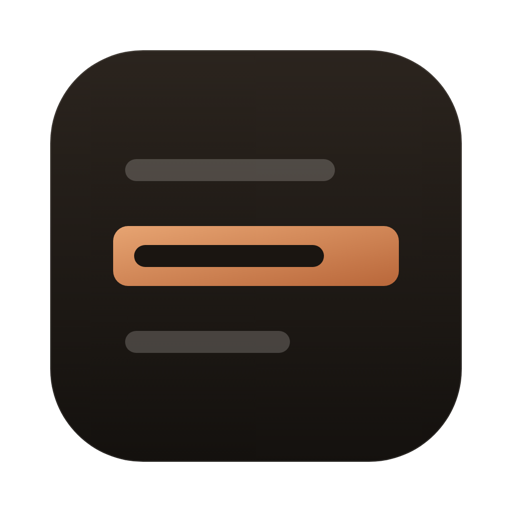
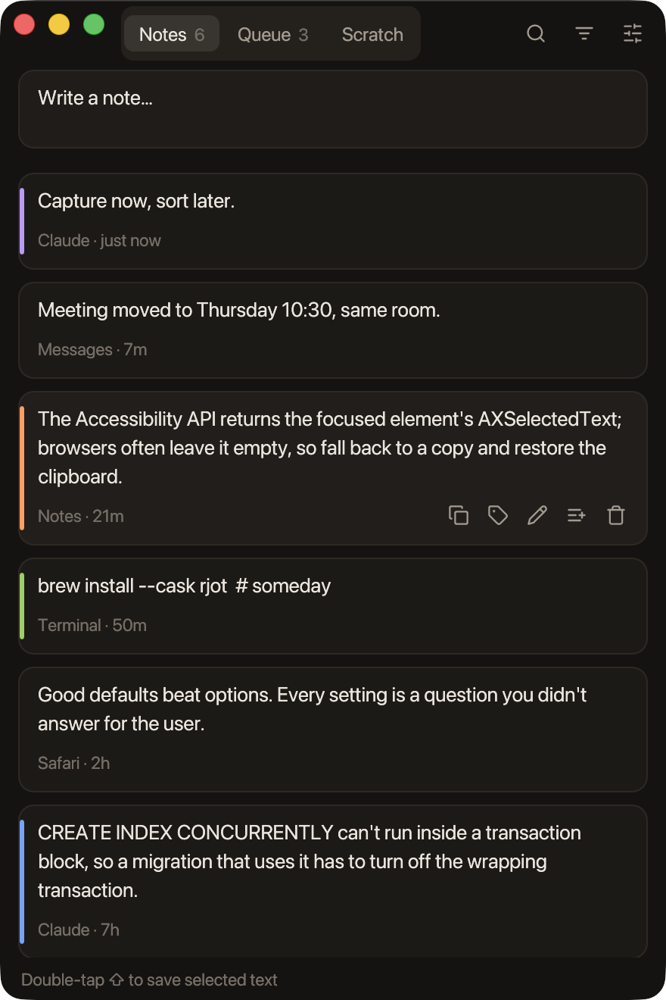
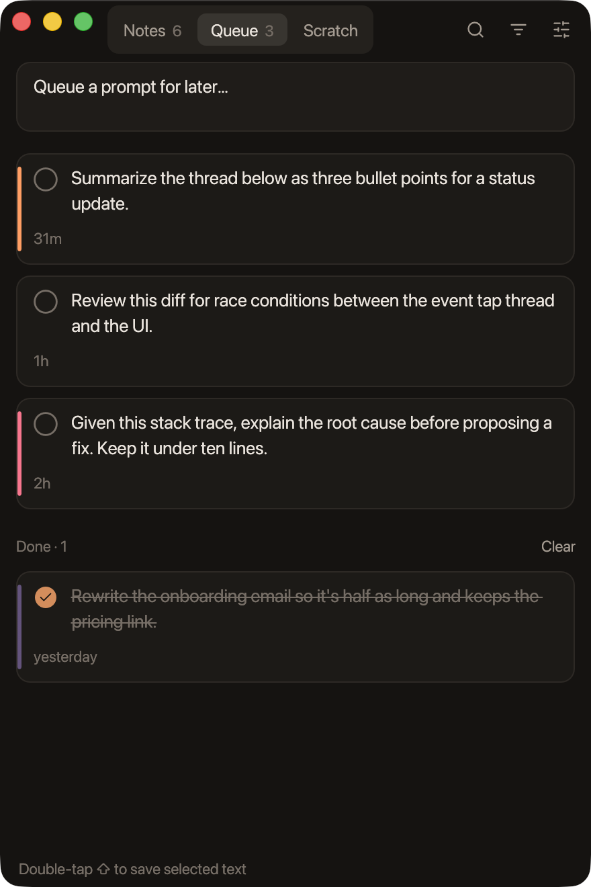
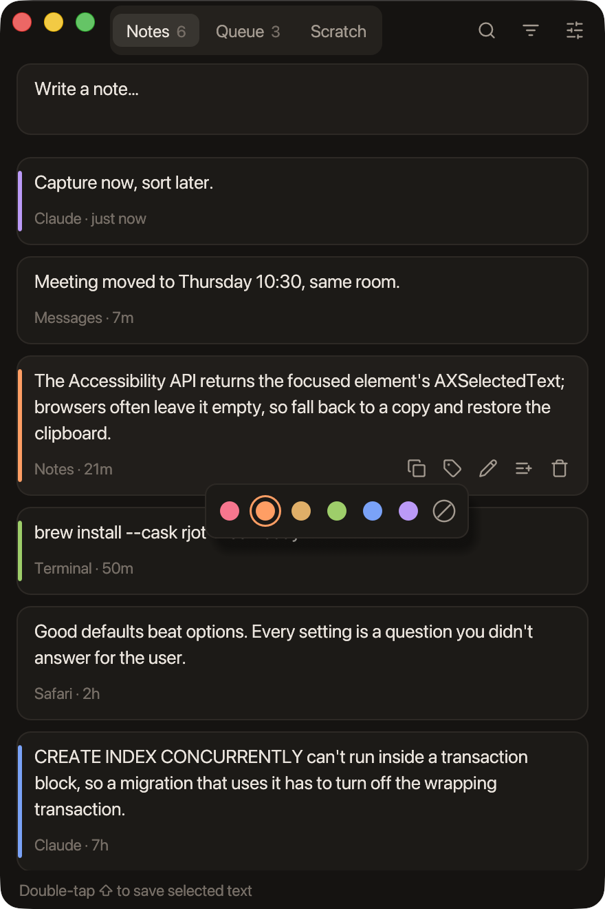
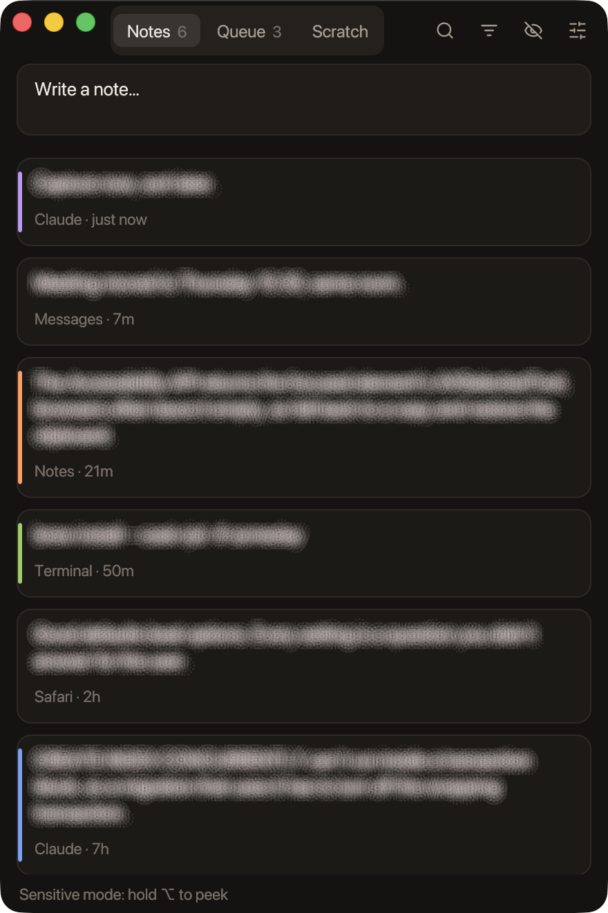
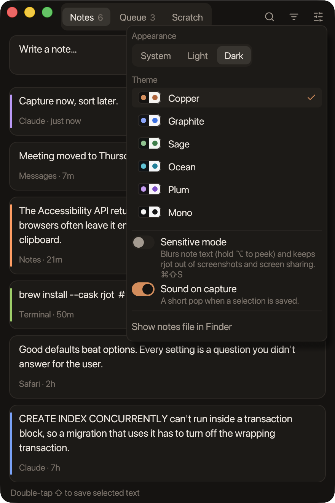
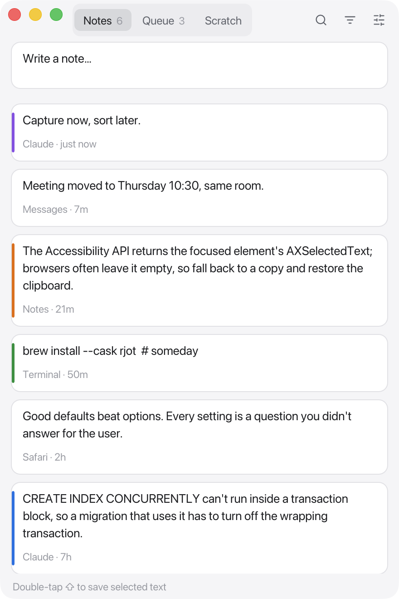
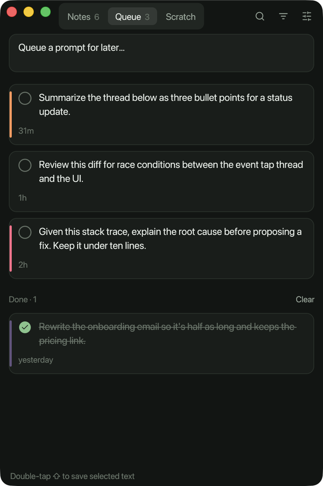

<p align="center"></p>

<h1 align="center">rjot</h1>

<p align="center">Keep the text you highlight. A small Mac app.</p>

<p align="center">
  <a href="https://github.com/yoouTaro/rjot/releases"></a>
  
  
</p>

<p align="center"></p>

Select text in any app and double-tap **⇧ Shift**. The selection is saved as a note, along with the name of the app it came from, and a short sound confirms it. You stay where you were. If nothing is selected, the same gesture brings rjot forward with the note box focused. Type a note and press ⌘↩, and rjot gets out of the way again.

It also has a **Queue** for prompts you want to use later (copying one checks it off) and a **Scratch** pad. Everything is kept in one local file at `~/Library/Application Support/dev.rjot.rjot/notes.json`. There is no sync, no account and no network access.

Built like [rgrip](https://github.com/yoouTaro/rgrip): Rust, egui, and one small binary.

## Install

Download the zip from [Releases](https://github.com/yoouTaro/rjot/releases), unzip it and move **rjot.app** to Applications. It's for Apple silicon. On other Macs, build from source.

It isn't notarized, so macOS blocks the first launch. Right-click **rjot.app** and choose **Open**, or run:

```sh
xattr -dr com.apple.quarantine rjot.app
```

Then allow it under System Settings → Privacy & Security → Accessibility.

<table>
  <tr>
    <td><br><sub>Queue: copy a prompt and it's checked off</sub></td>
    <td><br><sub>Color labels, and a filter by color</sub></td>
    <td><br><sub>Sensitive mode: blurred, ⌥ to peek</sub></td>
  </tr>
  <tr>
    <td><br><sub>Themes, appearance and settings</sub></td>
    <td><br><sub>Graphite, light</sub></td>
    <td><br><sub>Sage, dark</sub></td>
  </tr>
</table>

## Themes and sensitive mode

The settings menu (sliders icon) has six themes, each with a dark and a light palette: Copper, Graphite, Sage, Ocean, Plum and Mono. Appearance can follow macOS or stay light or dark.

**Sensitive mode** (⌘⇧S) blurs note and scratchpad text. Hold ⌥ to peek, or click into the scratchpad to edit it. It also keeps the rjot window out of screenshots, recordings and screen sharing. Whatever the mode, if a password manager marks a copy as concealed, rjot doesn't save it.

## How capture works

1. A listen-only event tap watches for two quick taps of Shift on its own, with no other key in between.
2. rjot asks the focused element for its selected text through the Accessibility API. Most native apps answer.
3. If an app doesn't answer (browsers and Electron apps often don't), rjot presses ⌘C and reads the clipboard. Then it puts the clipboard back the way it was, all types included.

rjot needs **Accessibility** access for this (System Settings → Privacy & Security → Accessibility). The app shows a button for it until access is granted.

## Build

```sh
sh scripts/make-signing-cert.sh   # once: a local code-signing certificate
sh scripts/bundle-macos.sh        # dist/rjot.app and a zip
cargo run -p rjot                 # debug
sh scripts/build-icon.sh          # re-render assets/ from assets/logo.svg
```

macOS ties the Accessibility permission to the app's signature. `make-signing-cert.sh` adds a self-signed "rjot Local Signing" certificate to your login keychain. The bundle script signs with it, so the permission survives rebuilds. Without the certificate, the app is ad-hoc signed and gets a new identity on every build. You then have to remove rjot from the Accessibility list and add it again after each rebuild.

`RJOT_DATA=/path/notes.json` uses a different note file. `sh scripts/screenshots.sh` re-captures the screenshots in `docs/screenshots` from scripted scenes with demo notes. It needs a debug build and leaves your own notes alone.

## Shortcuts

| Shortcut | Action |
|---|---|
| ⇧ ⇧ | Save the selection (anywhere) |
| ⌘↩ | Save the note or prompt being written |
| ⌘1 / ⌘2 / ⌘3 | Notes / Queue / Scratch |
| ⌘N | New note |
| ⌘F | Search |
| ⌘⇧S | Sensitive mode on/off |
| ⌥ (hold) | Peek at hidden text |
| ⌘W, close button | Hide (capture keeps working) |
| ⌘Q | Quit |

Double-click a card to edit it, and click a long card to expand it. Hover a card to copy, edit, color-label, move or delete it. A label shows as a stripe on the card, and the filter button next to search shows one color at a time. Deleting can be undone from the status bar.

## Known limits

- Apple silicon and macOS only, and not notarized (see Install).
- In some editors (VS Code, for example), ⌘C with nothing selected copies the whole line, so double-tapping ⇧ there saves that line.
- macOS 14 and later may decline to bring rjot forward from the background. If the quick note box doesn't appear, click the Dock icon.

## License

[MIT](LICENSE)
